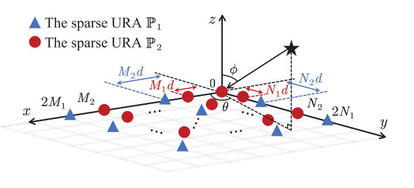
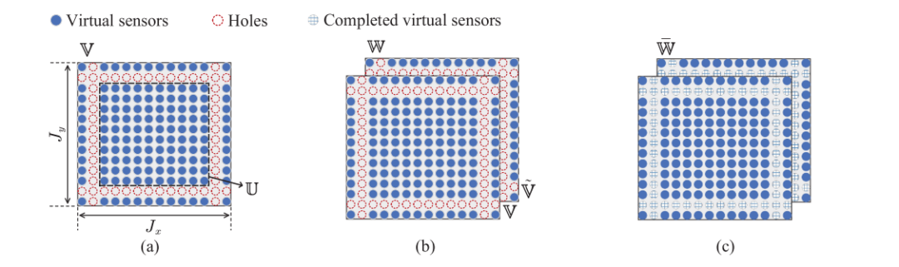
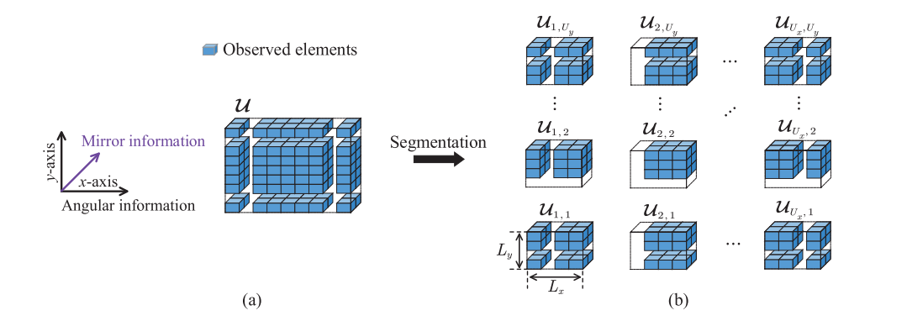
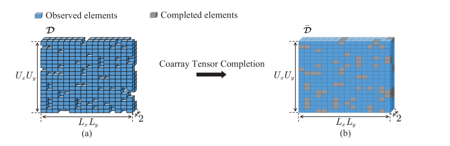
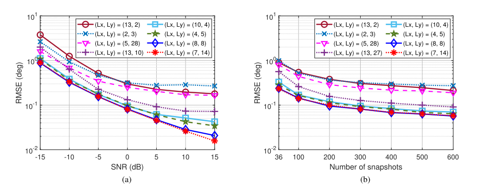
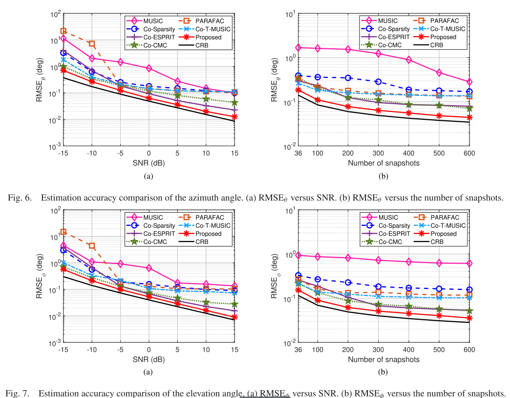
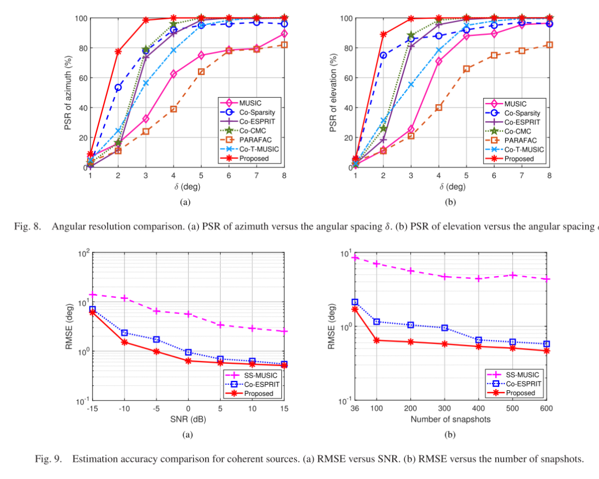

# DOA Estimation Based on Covariance Matrix Completion - [MATLAB Code Included]

Introduction: The use of sensor arrays for direction of arrival (DOA) estimation has been widely studied in fields such as radar, sonar, speech, and wireless communications [2], [3], [4], [5], [6]. Unlike uniform arrays, sparse arrays (including interleaved arrays [7], nested arrays [8], optimized configurations [9], [10], etc.), estimate the DOA at sub-Nyquist sampling rates, which helps to mitigate antenna coupling and system overload [11]. Generally speaking, an Augmented Virtual Array can be derived from the second-order signal statistics of a sparse array, used for Nyquist matched filtering [12], [13], [14]. Common methods based on the covariance matrix for DOA estimation include Covariance Matrix Based Multi-Signal Classification (MUSIC) [15], [16], Covariance Matrix Eigenstructure Inversion Technique (ESPRIT) [17], and Covariance Matrix Sparse Approaches [18], [19]. All these methods follow the same principle of matrix-based signal processing, that is, representing the received signals as matrices and then flattening their second-order covariance matrix statistics into vectors. However, as the dimensionality of sparse arrays increases, these methods cannot maintain the structure of multidimensional sub-Nyquist signals.
Tensors as extensions of matrices in high-dimensional spaces have been used for multi-dimensional array processing, where tensor decomposition [20] can estimate the potential multipath parameters in wireless communication and radar systems. Specifically, Vandermonde structured tensor decomposition methods [22] and Hermitian Toeplitz constrained tensor reconstruction methods [23] have been proposed to achieve 2-DDOA estimation for transmit beam space MIMO radar and coherent source DOA estimation for uniform rectangular arrays, respectively. By combining the tensor model with sub-Nyquist sampling, a tensor-based sub-Nyquist radar equipped with sparse arrays is proposed for DOA estimation [24], where the first-order sub-Nyquist tensor signals are recovered through tensor compression sensing. Recently, an enlarged multi-dimensional virtual array has been derived for coarray DOA estimation [25], [26], which propels the sub-Nyquist tensor model into the coarray domain. However, for partially extendable sparse arrays, such as representative mutually indivisible arrays, corresponding multi-dimensional discontinuous virtual arrays have hole slices [27], leading to entire slices of missing elements in the coarray. Existing partial extension sparse array coarray tensor DOA estimation methods must discard discontinuous virtual elements to extract a virtual uniform array. Therefore, they cannot utilize the entire coarray tensor statistics and the resulting reduction in aperture and resolution cannot be compensated by tensor processing. Thus, our goal is to fully utilize the derived virtual arrays to improve estimation performance.
To fully leverage the entire covariance matrix, virtual array interpolation techniques have been proposed for mutually disjoint line array DOA estimation. Two mainstream solutions are matrix completion and matrix reconstruction [28] and [29]. Particularly, matrix completion has been used to recover missing random elements in damaged data matrices by imposing low-rank regularization, which is typically relaxed to nuclear norm minimization. To complete the incomplete covariance matrix corresponding to discontinuous virtual line arrays, a method of nuclear norm minimization optimization was introduced to produce an interpolated virtual line array [28]. On the other hand, for unstructured DOA estimation, reconstructing the complete covariance matrix corresponding to the full array with atoms norm minimization [29] was proposed, where the Toeplitz property was used as a prior. However, these virtual linear array interpolation techniques are only applicable to incomplete matrices with discrete missing elements, and not to complete missing slices of coarray tensors.
Due to the strong correlation between adjacent missing elements in incomplete tensors, a low-rank regularized tensor completion technique is proposed for completing randomly missing elements [30]. Since image data is often corrupted by random missing pixels, low-rank tensor completion techniques have been applied to repair images [31]. However, the entire missing slice prevents adequate low-rank regularization of coarray tensors. To restore regularly damaged images with missing pixel slices, an interest has arisen in embedding spatial slice completion methods based on the Tucker or tensor training representations, which approximate through iterative rank increment processes [32], [33]. Nonetheless, neither the Tucker rank nor the tensor column rank increment operations match the standard multi-vector (CP) model of coarray tensors, meaning that existing slice completion methods for coarray tensor completion are not applicable. Recently, a tensor completion method based on CP approximation has been proposed for reconstructing functional magnetic resonance imaging (fMRI) data with regular sub-Nyquist sampling patterns, including missing fibers and slices [34]. However, the fMRI tensor reconstruction modifies observed elements in the incomplete tensor without modifying those in the incomplete tensor. It is expected to preserve the coarray tensor for DOA estimation. Therefore, effectively completing the missing coarray tensor for DOA estimation remains challenging. To our knowledge, this issue has not been addressed in the literature.
This paper proposes a two-dimensional sparse array DOA estimation algorithm based on covariance matrix tensor completion. Firstly, starting from the sub-Nyquist tensor statistics, an incomplete covariance matrix tensor of the augmented discontinuous virtual cubic array is derived. Due to the presence of integer missing elements in the covariance matrix tensor, traditional low-rank tensor completion techniques fail. To address this issue, by shifting dimensions and tensor compaction, the initial covariance matrix tensor is reconstructed into a structured covariance matrix with discrete missing elements. Additionally, the shape of the reconstructed covariance array is optimized by maximizing the degree of discreteness of the missing elements and minimizing their percentage. Therefore, by solving the problem of minimizing the nuclear norm of the covariance matrix using the Alternating Direction Method of Multipliers (ADMM), the reconstructed covariance matrix can be successfully obtained. Furthermore, the global convergence of ADMM for covariance matrix completion is demonstrated. Finally, the full covariance matrix corresponding to the filled virtual cubic array is decomposed, yielding closed-form solutions for azimuth and elevation angles. Numerical simulation results show that this algorithm achieves superior accuracy and resolution compared to traditional methods based on matrices and tensors, and can handle both uncorrelated and fully correlated signals simultaneously.
In our previous work on sparse array DOA estimation [27], we extracted the continuous parts of multi-dimensional discontinuous virtual arrays for covariance array tensor processing without addressing the issue of completing slice covariance array tensors. However, in this paper, we focus on utilizing the entirety of the covariance array tensor statistics to further enhance estimation performance. For the problem of DOA estimation of coherent sources in a multipath environment, we propose a uniform array tensor de-correlation method [23] that does not consider sub-Nyquist sampling situations. In contrast, this paper validates the effectiveness of covariance array tensor processing for coherent source estimation under sparse array conditions. The preliminary results of this work have been introduced in our conference paper [1]. In this article, we will further investigate the optimal structure of reconstructed covariance array tensors through designing an optimization problem for the size of the covariance array sub-tensor, and provide detailed derivations for the covariance array tensor completion problem. Additionally, we will provide theoretical analyses on the degree of dispersion of missing elements in the reconstituted covariance array tensor, the overall convergence of the covariance array tensor completion, as well as computational complexity.
Article illustration
To solve the 2-DDOA estimation problem, we propose a covariance array tensor completion algorithm. This algorithm fully utilizes the discontinuous virtual arrays obtained from the mutual correlation tensor statistics and represents the corresponding equivalent second-order signal with an incomplete covariance array tensor. To effectively regularize the covariance array tensor by low rank, the entire missing slice is sufficiently dispersed under the principle of maximizing the DPR of missing elements. Therefore, the reconstituted covariance array tensor can be completed by solving the core problem of minimizing the nuclear norm of the covariance array tensor via ADMM. Furthermore, theoretical proofs are provided for the global convergence of the covariance array tensor completion problem. Then, by applying CPD to the complete covariance array tensor corresponding to the filled virtual array, we estimate the 2-D DOA of the source in a closed form. Simulation results confirm superior performance in estimation accuracy and resolution compared to competing methods.
This algorithm can be extended to other parameter estimation scenarios of partially expandable sparse arrays. For example, the method for tensor completion with slice-deficient coarrays can be applied to sparse MIMO systems to fully utilize joint angle/frequency estimation from multidimensional coarray statistics. Additionally, in imaging scenarios, the designed tensor segmentation and structured tensor formulation methods can be used for image restoration or acceleration of imaging processes.

## Images

<!-- PAYMENT_BLOCK -->

## Get this dataset

- Payment link (Stripe): [Buy now](https://buy.stripe.com/3cs8yP7sY87d0vu9AB)
- Payment QR code: 

<!-- /PAYMENT_BLOCK -->
